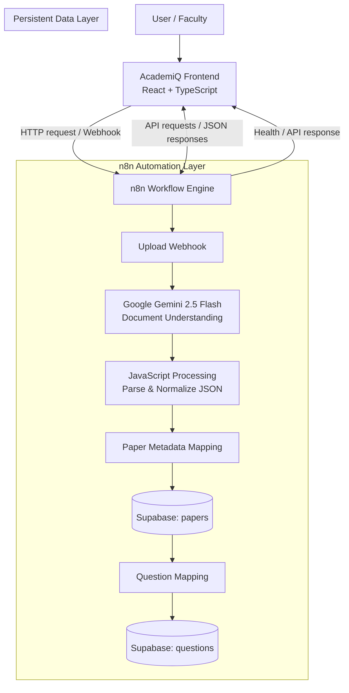
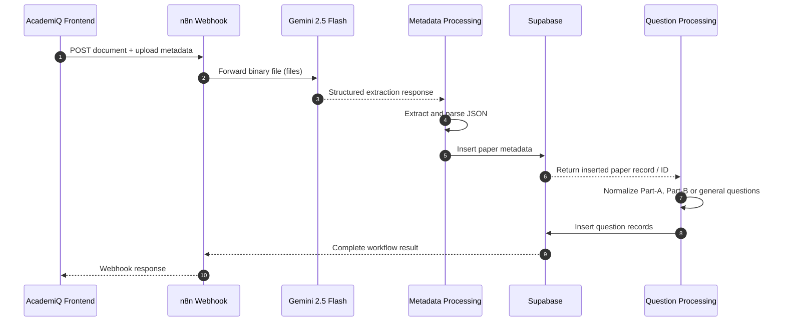

<div align="center">

# ⚙️ AcademiQ — n8n Workflow Backend

**Workflow automation, AI-powered question-paper extraction, and API integration layer**

[](https://n8n.io/)
[](https://ai.google.dev/)
[](https://supabase.com/)
[](https://docs.n8n.io/)

[](https://github.com/Pratham-U-dev/Question-paper-analyser)
[](https://docs.n8n.io/)
[](https://supabase.com/docs)

*Part of [AcademiQ — Vision-Based Academic Intelligence System](../README.md)*

</div>

---

## 📌 Overview

This directory contains the **n8n workflow exports** used by AcademiQ to connect the frontend with AI-powered document processing and the Supabase database.

Rather than maintaining a separate traditional backend server for these operations, AcademiQ uses **n8n webhooks and workflow nodes** to orchestrate the processing pipeline.

The workflows handle:

- Receiving uploaded academic question-paper documents.
- Sending document binaries to Google Gemini for vision-based extraction.
- Converting the model's structured JSON response into database-ready records.
- Inserting paper metadata and individual questions into Supabase.
- Exposing webhook endpoints for health checks and, in earlier workflow versions, subject lists and analytics data.

> **Architecture note:** This folder stores workflow configuration/export files. It is not a standalone Node.js, Express, or FastAPI application. n8n executes the workflows, while Supabase provides persistent relational storage for the structured records. The current workflow does not configure persistent object storage for the original uploaded PDF.

## 🧱 Architecture

### 1. High-level system architecture



### 2. Question-paper upload and extraction flow

The latest `PBL_v02.0.1.json` workflow implements the following main processing sequence:



### 3. Extraction and database mapping

Gemini is instructed to return a structured representation of the paper. The JavaScript nodes then map the extracted content into two relational tables.

| Extraction structure | Database destination |
|---|---|
| Institution header | `papers.institution_name` |
| Examination name | `papers.examination_name` |
| Subject | `papers.subject_name` |
| Subject code | `papers.subject_code` |
| Exam year | `papers.exam_year` |
| Paper type | `papers.paper_type` |
| Duration | `papers.duration` |
| Maximum marks | `papers.maximum_marks` |
| Question text and number | `questions.question_text`, `questions.q_no` |
| Bloom's level | `questions.blooms_level` |
| Course outcome | `questions.course_outcome` |
| Program outcome | `questions.program_outcome` |
| Marks | `questions.marks` |
| Part and module | `questions.part`, `questions.module` |

The question-processing logic supports three extraction layouts:

- **General question table:** maps entries from `questions_table.questions`.
- **Part-A:** maps entries from `part_a.questions`.
- **Part-B:** iterates through modules and maps their individual rows.

Questions without a `Question` value are skipped by the current processing function.

---

## ✨ Workflow capabilities

| Capability | Description |
|---|---|
| 📤 Document ingestion | Accepts a binary document through an n8n POST webhook. |
| 👁️ Vision-based extraction | Uses Gemini 2.5 Flash through the n8n Google Gemini node. |
| 🧠 Structured AI output | Extracts examination details, question text, marks, BL, CO, PO and module structure. |
| 🔄 Data transformation | JavaScript nodes parse model output and normalize records. |
| 🗄️ Database integration | Inserts paper metadata and extracted questions into Supabase. |
| ❤️ Health check | Provides a lightweight workflow health response. |
| 📊 Analytics support in earlier versions | Earlier exports include subject listing, summary, module frequency, Bloom's distribution and question-bank retrieval workflows. |

## 📂 Directory structure

```text
n8n_backend/
│
├── PBL_v01.json
├── PBL_v01.1.json
├── PBL_v02.json
├── PBL_v02.0.1.json
│
└── README.md
```

Each `.json` file is an exported n8n workflow. Import the required version into an n8n instance to inspect, configure, and execute it.

## 🗂️ Workflow versions

The files represent the evolution of the automation layer. **`PBL_v02.0.1.json` is the latest reference workflow documented here.**

| Version | Main characteristics | Exported active state |
|---|---|---|
| `PBL_v01.json` | Initial integrated workflow: upload, subjects, analytics summary, frequency, Bloom's distribution and question retrieval. | Inactive |
| `PBL_v01.1.json` | Updated v01 workflow with an additional upload response node. | Inactive |
| `PBL_v02.json` | Simplified Gemini 2.5 Flash document-upload and database-insertion workflow. | Inactive |
| **`PBL_v02.0.1.json`** | Latest upload workflow plus a health-check endpoint. | **Active in exported JSON** |

### Version differences worth knowing

- The v01 and v01.1 exports contain the broader set of subject and analytics webhook branches.
- The v02 export focuses on the document-upload pipeline.
- v02.0.1 retains the upload pipeline and adds a `/health` webhook that returns a JSON health response.
- The v02.0.1 export does **not** contain the earlier subject-list, analytics, or question-fetch webhook branches.

The `active` value in an exported JSON file describes the exported workflow state; always verify activation after importing it into your own n8n instance.

---

## 🔌 Webhook API reference

The routes below describe the webhook paths found in the supplied exports. They are relative to your n8n instance URL.

### Latest workflow — `PBL_v02.0.1.json`

| Method | Webhook path | Purpose |
|---|---|---|
| `POST` | `/webhook/e73ea951-993b-4149-9b8e-076a0fd07879` | Upload and process a question paper |
| `GET` | `/webhook/health` | Return workflow health information |

The upload webhook uses the binary property name `files`. The metadata-processing code reads these fields from the webhook request body:

| Field | Purpose |
|---|---|
| `subject_code` | Subject identifier associated with the paper |
| `exam_year` | Examination year |
| `paper_type` | Type/category of examination paper |
| `role` | Uploading user's role, stored as `upload_role` |

The exact request encoding and frontend field names should match the webhook configuration used by your deployed frontend. The exported workflow does not document a formal request schema or a custom response contract for the upload endpoint.

#### Health-check response

The health workflow constructs a response with the following structure:

```json
{
  "status": "ok",
  "service": "n8n",
  "workflow": "PBL_Vision-workflow",
  "timestamp": "ISO-8601 timestamp"
}
```

The timestamp is generated when the workflow executes.

### Earlier workflow routes — v01 / v01.1

These routes are present in the earlier exports. They should be treated as **historical workflow capabilities**, not as endpoints guaranteed to exist in v02.0.1.

| Method | Webhook path | Purpose |
|---|---|---|
| `POST` | `/webhook/papers/upload` | Upload and process a paper |
| `GET` | `/webhook/subjects` | Retrieve distinct subject codes |
| `GET` | `/webhook/analytics/summary` | Retrieve paper/question counts and average marks |
| `GET` | `/webhook/analytics/frequency` | Retrieve module-wise question frequency |
| `GET` | `/webhook/analytics/blooms` | Retrieve Bloom's-level counts |
| `GET` | `/webhook/questions` | Retrieve questions for a subject |

The summary and question-fetch workflows use a `subject_code` query parameter in their Supabase filtering logic. Review the individual workflow nodes and filters before reusing any historical route.

> **Important:** Do not assume the older endpoints are available just because their JSON files are present in this directory. Importing or activating a particular workflow is required.

---

## 🗄️ Data persistence

AcademiQ uses **Supabase (PostgreSQL)** as its structured data store.

The latest upload workflow writes to two tables:

### `papers`

Stores the extracted examination-level metadata.

Representative fields:

```text
institution_name
examination_name
subject_name
subject_code
exam_year
paper_type
duration
maximum_marks
upload_role
```

### `questions`

Stores individual extracted question records.

Representative fields:

```text
paper_id
subject_code
part
module
q_no
sub_question
question_text
blooms_level
course_outcome
program_outcome
marks
```

The `paper_id` field associates question records with their parent paper. The workflow expects the Supabase schema and column names to match its mapped output.

**Storage clarification:** Supabase database insertion provides persistence for the structured records. The supplied workflow does not show a Supabase Storage upload or another object-storage step for retaining the original PDF. The workflow JSON files themselves are configuration exports, not a database or document repository.

---

## 🚀 Setup and deployment

### Prerequisites

- An accessible n8n instance (cloud or self-hosted).
- A Google Gemini API credential configured in n8n.
- A Supabase project with the required tables.
- The AcademiQ frontend configured to call the deployed webhook URLs.

### 1. Import the workflow

1. Open your n8n instance.
2. Create or open a workflow.
3. Use **Import from File**.
4. Select `PBL_v02.0.1.json`.
5. Review the imported nodes and connections.

### 2. Configure credentials

Reconnect the required credentials in the imported workflow:

| Integration | Configuration |
|---|---|
| Google Gemini | Configure a valid Google Gemini API credential for the document-analysis node. |
| Supabase | Configure a valid Supabase credential for the `papers` and `questions` operations. |

Credential references inside an exported JSON file do not transfer the actual API secrets. Select or recreate the credentials in your own n8n instance.

### 3. Verify the database

Ensure that your Supabase project contains:

- A `papers` table with columns matching the paper metadata mapping.
- A `questions` table with columns matching the question mapping.
- An appropriate relationship between `questions.paper_id` and the parent paper record.

Use the same data types expected by the workflow. In particular, the JavaScript transformation converts the exam year, maximum marks, Bloom's level and question marks into numeric values.

### 4. Activate and test

1. Verify the Gemini and Supabase nodes.
2. Test the upload workflow with a representative academic question paper.
3. Verify that one paper record and its associated question records are inserted.
4. Test the `/health` endpoint.
5. Activate the workflow.
6. Copy the production webhook URLs from n8n.
7. Configure the frontend to use those production URLs.

### 5. Connect the frontend

The frontend should send the uploaded document and associated metadata to the upload webhook. It should use the webhook URLs exposed by the currently deployed workflow rather than assuming that all historical endpoints are available.

---

## 🔐 Security and operational considerations

This is a project-level workflow implementation. Before using it in a production environment, consider the following:

| Area | Current consideration | Recommended improvement |
|---|---|---|
| Webhook access | The latest upload webhook allows all origins through `allowedOrigins: "*"`. | Restrict allowed origins to trusted frontend domains. |
| Authentication | No explicit webhook authentication mechanism is configured in the supplied workflow. | Add authentication and authorization before accepting uploads. |
| File validation | The workflow passes the binary property to Gemini. | Validate file type, size and upload content before processing. |
| AI output | The JavaScript nodes parse Gemini output using `JSON.parse()`. | Add schema validation and graceful handling of malformed output. |
| Database writes | Paper metadata and question records are inserted in separate steps. | Consider transaction handling and cleanup for partially completed uploads. |
| Duplicate uploads | No explicit deduplication mechanism is visible in the upload flow. | Add a suitable unique constraint or duplicate-detection strategy. |
| Original documents | No persistent PDF/object-storage step is present in the latest workflow. | Add Supabase Storage or another object-storage service if document retention is required. |
| Secrets | API credentials are configured through n8n credential references. | Keep secrets in n8n credentials or environment configuration; never commit API keys. |

---

## ⚠️ Current scope and limitations

The following points describe the supplied workflow exports, rather than features that have been independently load-tested:

- The workflow depends on Gemini returning JSON that can be parsed by the JavaScript nodes.
- OCR/extraction quality depends on document quality and model output.
- The current question-processing code skips rows without question text.
- Numeric conversions may produce `null`-equivalent fallback values for missing or unparseable fields.
- The supplied workflow does not show a dedicated error-handling and retry pipeline.
- The latest workflow does not include the historical analytics and question-fetch endpoints.
- The latest workflow does not demonstrate persistent storage of the original uploaded document.
- The health endpoint confirms that its workflow branch can return a response; it is not a comprehensive test of Gemini or Supabase connectivity.

## 🧰 Technology stack

| Component | Technology | Responsibility |
|---|---|---|
| Workflow orchestration | n8n | Webhooks, node execution and integration |
| Document AI | Google Gemini 2.5 Flash | Vision-based document understanding and extraction |
| Transformation | JavaScript (n8n Code nodes) | JSON parsing, normalization and field mapping |
| Database | Supabase / PostgreSQL | Structured paper and question persistence |
| Frontend integration | HTTP webhooks | Communication between AcademiQ and n8n |

## 🔗 Related resources

- **Main project:** [AcademiQ — Vision-Based Academic Intelligence System](../README.md)
- **Repository:** [PBL_frontend on GitHub](https://github.com/23e46pratham-lab/PBL_frontend)
- **n8n documentation:** [docs.n8n.io](https://docs.n8n.io/)
- **n8n webhook documentation:** [Webhook node](https://docs.n8n.io/integrations/builtin/core-nodes/n8n-nodes-base.webhook/)
- **Google Gemini API:** [ai.google.dev](https://ai.google.dev/)
- **Supabase documentation:** [supabase.com/docs](https://supabase.com/docs)

---

## 🎓 Project context

AcademiQ was developed as part of the **Course-Level Problem-Based Learning (CLPBL) initiative** at **St. Joseph Engineering College, Mangaluru**.

The project received **3rd Place at the CLPBL Project Showcase**.

This workflow directory documents the automation and integration layer that supports the larger AcademiQ application. For the complete project overview, features, and frontend setup, refer to the [main repository README](../README.md).

---

<div align="center">

**AcademiQ — Turning question papers into structured academic intelligence.**

<sub>Workflow exports and integration documentation · Maintained alongside the AcademiQ project</sub>

</div>
